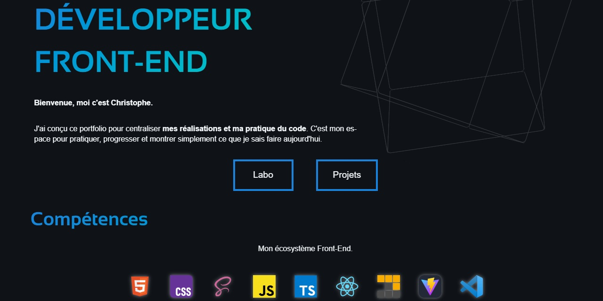

  

## Objectif du portfolio

Ce portfolio me permet de présenter mes projets tout en mettant en pratique les outils et les méthodes du développement Front-End.

### Réalisations techniques

- Une application React et TypeScript organisée autour de composants.
- Un routage côté client avec React Router entre l’accueil, les projets et le laboratoire.
- L’intégration de l’API GitHub pour charger les dépôts de façon asynchrone, gérer les états de chargement et d’erreur, et annuler les requêtes devenues inutiles.
- Des filtres interactifs par technologie, basés sur les topics des dépôts GitHub.
- Une interface responsive conçue en mobile-first, avec un thème clair ou sombre (par défaut, initialisé selon la préférence du navigateur).
